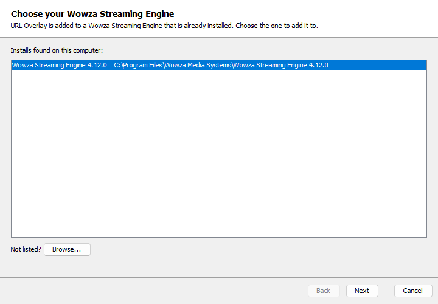
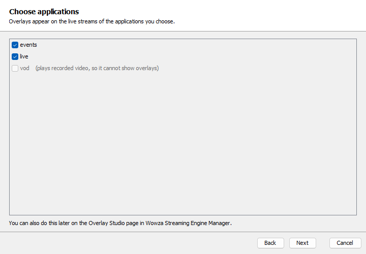
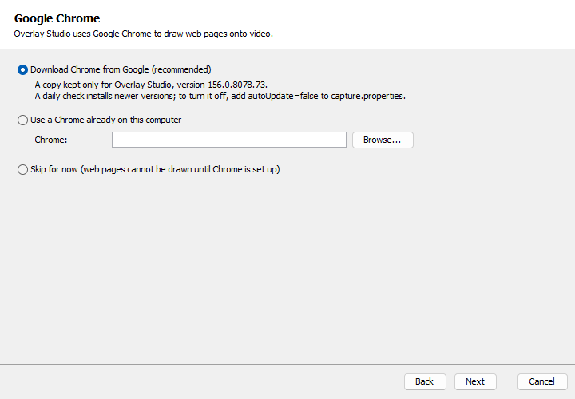
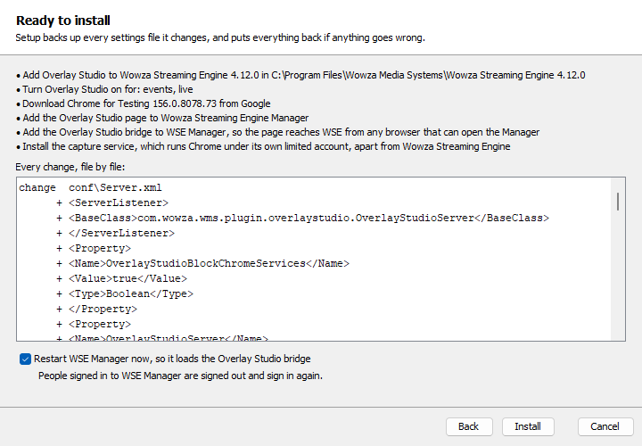
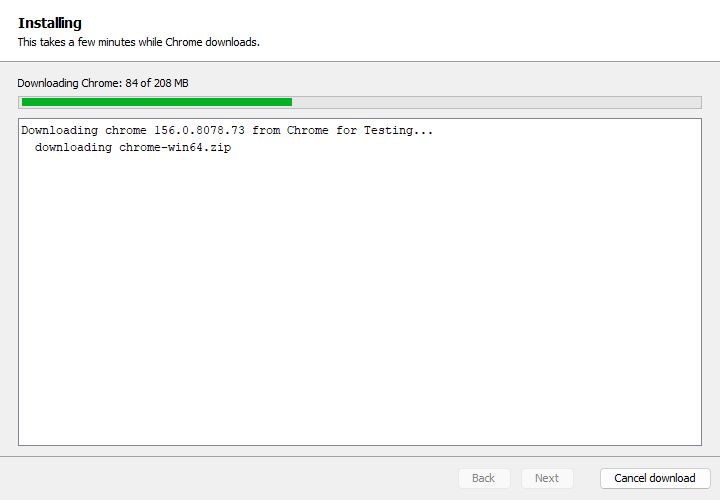
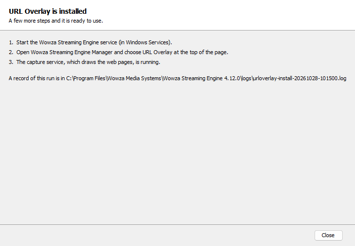
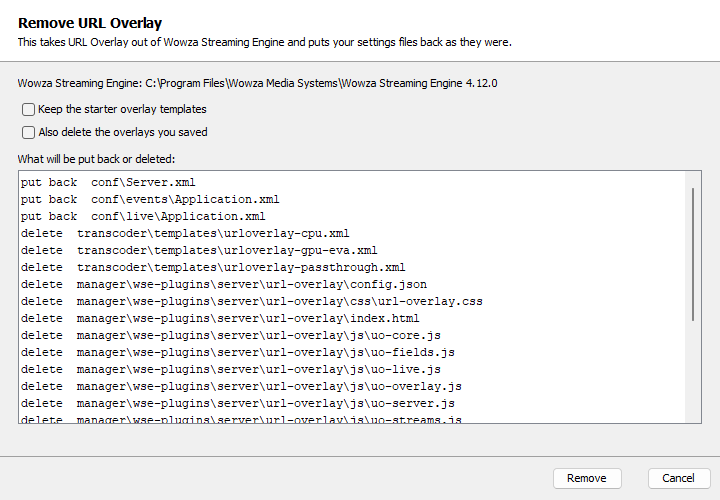

# Building Overlay Studio

## Prerequisites

| Tool | Why |
|---|---|
| JDK 21 with `jpackage` and `jdeps` on the PATH | Gradle runs on it; the capture service and the bridge are compiled for Java 21, the module and installer for Java 17. `jpackage` and `jdeps` build the Windows setup program |
| A WSE install, or a copy of its `lib/` folder | The module compiles and tests against WSE's own jars (never packaged). `module/build.gradle` looks for them only when a task needs the module's classpath (its compile, tests and jar, and so the installer), so the capture service and the bridge build without WSE. Found in this order: `-PwseLibDir=<path>`, the `WSE_HOME` environment variable (`$WSE_HOME/lib`), `/usr/local/WowzaStreamingEngine/lib`, then the single install under `C:\Program Files\Wowza Media Systems\`. Several Windows installs and no override stop the build |
| WiX 3.14.1, Windows only | For the setup program. Unpack `wix314-binaries.zip` (WiX 3.14.1 release) into `tools/wix/3.14.1/` so that `tools/wix/3.14.1/candle.exe` exists. `tools/` is not in the repository |
| Python 3.12 or later | Runs `packaging/build_dist.py` (standard library only) |

Gradle itself comes from the wrapper (`gradlew`, `gradlew.bat`, Gradle 8.10). Every other dependency comes from Maven
Central: JUnit 5, and the Spring and Jakarta APIs the bridge compiles against. The capture service has no third-party
libraries: it drives Chrome over DevTools with the JDK's own WebSocket client.

## Build the packages

```
python packaging/build_dist.py [--skip-tests] [--skip-exe] [--maintainer NAME]
```

| Flag | Effect |
|---|---|
| (none) | Builds the installer jar, runs `:module:test`, `:installer:test`, `:capture:test` and `:bridge:test`, then builds every package |
| `--skip-tests` | Builds without running those tests |
| `--skip-exe` | No Windows setup program, so no `jpackage` or WiX needed (the way to build on Linux) |
| `--maintainer NAME` | The `Maintainer` field of the `.deb` (default `Wowza Media Systems`) |

The version comes from `version` in `gradle.properties`. Output goes to `dist/wse-overlay-studio-<version>/`, which is
deleted and rebuilt on every run:

| File | What it is |
|---|---|
| `Wowza-Overlay-Studio-<version>.exe` | Windows setup program: the installer with its own Java 21 runtime, Start menu entries **Wowza Overlay Studio** and **Uninstall Overlay Studio**, and the console launcher `overlaystudio-cli.exe`. No spaces in the name, so GitHub keeps it as it is |
| `wse-overlay-studio-<version>-windows.zip` | Installer jar, `install.cmd`, `uninstall.cmd`, `update-chrome.cmd`, `find-java.cmd`, docs |
| `wse-overlay-studio-<version>-linux.tar.gz` | Installer jar, `install.sh`, `uninstall.sh`, `update-chrome.sh`, `find-java.sh`, docs |
| `wse-overlay-studio_<version>_all.deb` | Installs to `/opt/wse-overlay-studio/`; `preinst` refuses while 1.x is on the machine, `postinst` runs `install.sh --yes`, `prerm` runs `uninstall.sh --yes` on removal |
| `README.md`, `THIRD-PARTY-NOTICES.md` | Copies of the repository files |
| `SHA256SUMS` | SHA-256 of the four packages above, the files a release carries |

Every package carries `README.md`, `THIRD-PARTY-NOTICES.md`, `LICENSE.txt` and `licenses/apache-2.0.txt`; the setup
program installs them in its program folder's `app\`. hls.js's license also goes with it, as `vendor/hls.js-LICENSE.txt`
in the plugin page. The zip,
tarball and `.deb` use fixed entry times, so the same installer jar gives byte-identical archives; the setup program
does not. The `.deb` is assembled by the script (ar and tar), so `dpkg-deb` is not needed.

The installer jar, `installer/build/libs/wse-plugin-overlay-studio-installer-<version>.jar`, carries everything it
installs: the module jar, the plugin page, the starter templates, the bridge's class files and the capture service, with
no libraries. The setup program's runtime is linked with the modules `jdeps` finds in the installer jar and in the
capture service, plus `java.base`, `java.desktop`, `java.net.http` and `jdk.crypto.ec`, which `jdeps` cannot see; the
build fails if one is missing.

## Run the tests

```
./gradlew :module:test
./gradlew :capture:test
./gradlew :bridge:test
./gradlew :installer:test
./gradlew renameCheck           # no 1.x name left in the shipped tree
./gradlew build                 # all of the above, plus the jars
```

<!-- 1x-compat:begin -->
`renameCheck` fails on any 1.x name (`url-overlay`, `urloverlay`, `uo-`, `UO_` and the like) in the files git lists
under the shipped folders and docs, except in the 1.x check's own files and between marker comments
(`1x-compat:begin`, `1x-compat:end`). It is skipped outside a git checkout. Source: `gradle/rename-check.gradle`.
<!-- 1x-compat:end -->

On Windows use `gradlew.bat`. `build_dist.py` runs all four unless `--skip-tests` is given. What the tests cover, and
what they do not, is in [DESIGN.md](DESIGN.md#testing).

### Page tests

The page's tests live in `tests/ui` and need Node.js 20 or later and Python 3; Gradle does not run them.

```
cd tests/ui
npm ci
npx playwright install chromium     # once; skip if Playwright 1.63's Chromium is already installed
npx playwright test
python -I labels_test.py <wse source root>
```

`npx playwright test` runs the smoke flows in headless Chromium against a fake bridge (`fake-wse.js`), so no WSE or
Manager is needed. `labels_test.py` reads WSE's own REST classes from a WSE source checkout. After changing a starter
template or the template validator, regenerate the fake's templates with
`OVS_WRITE_UI_FIXTURES=1 ./gradlew :module:test --tests '*UiFakeContractTest'`.

`./gradlew :installer:setupScreenshots` paints the setup window's screens with sample data into `docs/images/`.

### Troubleshooting

- **`./gradlew: Permission denied`** on a checkout made before 1.15.1: `chmod +x gradlew`. The repository marks it
  executable since then.
- **`Unable to establish loopback connection`** from Gradle or the tests on Windows. Java 21 makes its internal
  pipe a Unix socket in the temp folder, and some machines' security software blocks those under the user's
  `AppData\Local\Temp`. Point Java at another folder for the run, for example in Git Bash
  `JAVA_TOOL_OPTIONS=-Djdk.net.unixdomain.tmpdir=C:/Temp ./gradlew build`, or in PowerShell
  `$env:JAVA_TOOL_OPTIONS='-Djdk.net.unixdomain.tmpdir=C:\Temp'` first. The build does not set it.

## Project layout

| Folder | Holds |
|---|---|
| `module/` | The WSE module: server listener, application module, REST resources, template builder, starter templates |
| `bridge/` | The Manager bridge: one Spring controller, compiled against the Manager's Spring 6 and Jakarta Servlet 6 |
| `capture/` | The capture service: Chrome over DevTools, shared between pages, the egress proxy, the socket server |
| `shared/` | Source compiled into more than one jar: the capture protocol, egress rules, browser pool, byte-preserving config edits |
| `installer/` | The installer jar and the Windows setup window; install, uninstall, verify and Chrome update |
| `ui/` | The plugin page served by WSE Manager: HTML, CSS, JavaScript, and its own copy of hls.js |
| `packaging/` | `build_dist.py`, the Windows and Linux wrapper scripts, `.deb` scripts, the WiX source |
| `tests/` | Fixtures the installer tests use (copies of stock WSE configuration) |
| `docs/` | Usage, design, this file, and the images they use |
| `gradle/` | The Gradle wrapper |

## Installing on Windows

The setup program installs itself to `%ProgramFiles%\Wowza Overlay Studio`; the capture service and its Chrome go to
`%ProgramFiles%\Wowza Overlay Studio Service` (`capture\`, `chrome-for-testing\<version>\`). When it finishes, the setup program opens the setup window,
which asks Windows for administrator rights itself. Stop the Wowza Streaming Engine service first.

**1. Choose the WSE install.** Every install found is listed; **Browse** finds one that is not.



**2. Choose the applications.** Live applications can be ticked; VOD applications are listed but cannot show an
overlay. None is required: Overlay Studio can be added to an application later from the plugin page.



**3. Chrome.** Download Chrome for Testing from Google, use a Chrome already on the computer, or skip (no page is
drawn until Chrome is set up).



**4. Review.** A summary, then every change file by file. **Restart WSE Manager now** loads the bridge at once; people
signed in to the Manager are signed out.



**5. Progress.** Each step as it runs. A failure rolls back what the run changed.



**6. Done.** What to do next, whether the capture service is running, and where the run's log is.



**Removing.** **Uninstall Overlay Studio** in the Start menu lists every file it puts back or deletes, with options to
keep the starter templates or also delete the saved overlays. Windows Settings, Apps, **Wowza Overlay Studio**,
Uninstall removes the setup program and runs the same removal without prompts. Stop WSE before removing.


