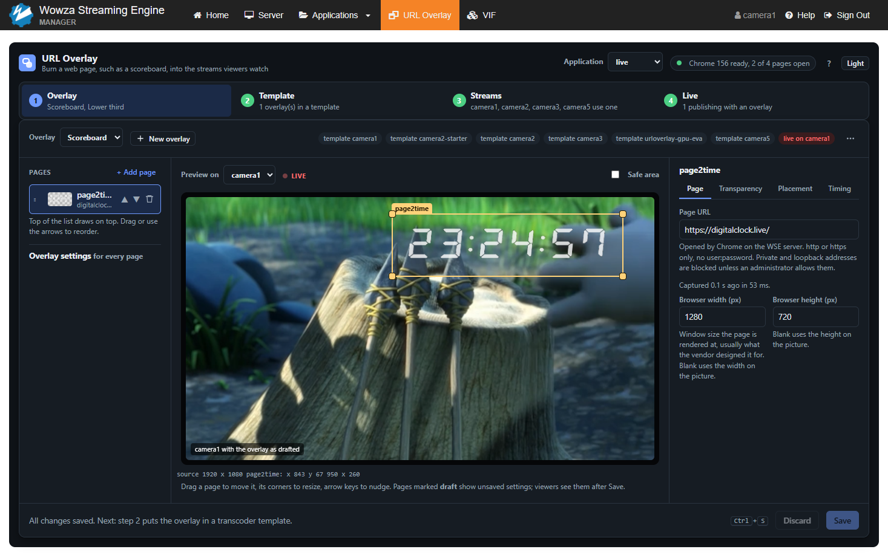
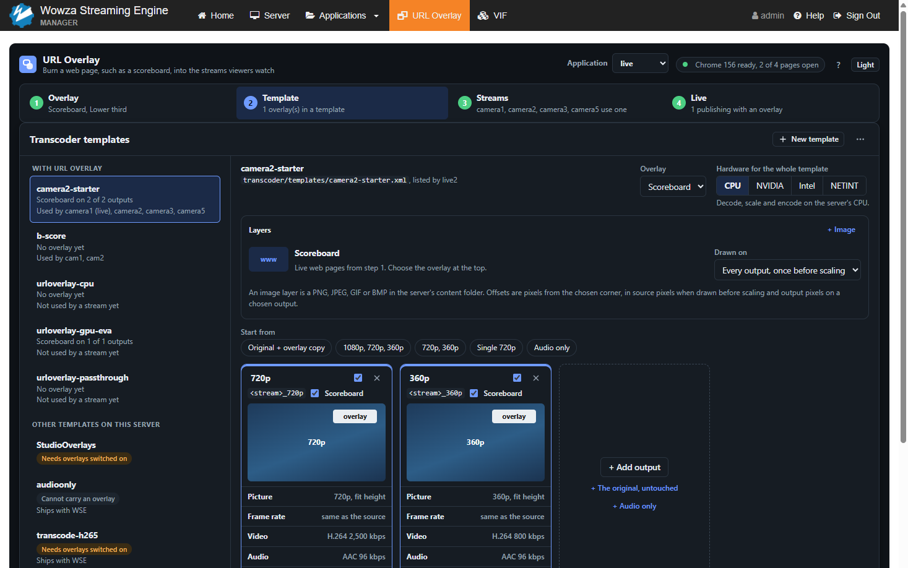
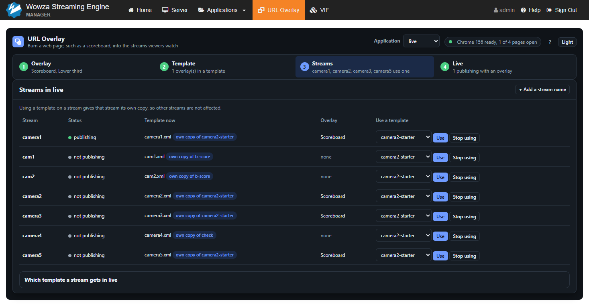
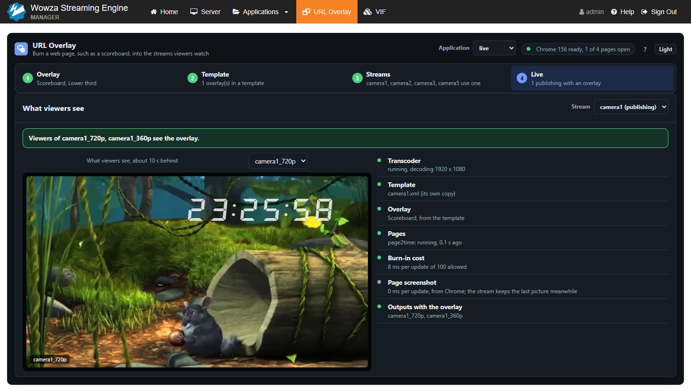

# Using URL Overlay

Open WSE Manager, choose **URL Overlay** in the top bar, and pick an application in the header. The page follows four
steps, left to right, and marks each one done from what exists on the server. It keeps itself current: a change made
in another browser, through REST or by editing a file shows within a few seconds.

An overlay reaches viewers only through a transcoder template: the overlay is named in a template, the template is
used by a stream, and the outputs that template builds carry the overlay.

Changes need a WSE administrator (a REST user in the `admin` group). Anyone else sees the page read only.

The screenshots use a test feed from *Big Buck Bunny* (c) Blender Foundation, www.bigbuckbunny.org, licensed under
CC BY 3.0, with a public clock page as the overlay.

## 1. Overlay

An overlay is a named set of pages placed on the video, saved per application in
`conf.modules/urloverlay/<application>/<overlay>.json`.

- **New** makes an overlay. Add a page by its URL; the page list draws the top entry on top, and entries can be
  dragged to reorder.
- **The preview** shows a publishing stream with each page's latest capture placed on it. Drag a page to move it,
  drag its corners to resize it, or nudge it with the arrow keys.
- **The inspector** has four tabs for the selected page:

| Tab | Settings |
|---|---|
| Page | Page URL (http or https, no `user:password`); browser width and height the page is rendered at |
| Transparency | The capture as taken and after keying side by side; click the left one to pick the key color. Tolerance (0 to 255); whether to paint the page's own background with the key color |
| Placement | X, Y, width and height on the source picture; opacity; **Crop the page** to show only part of it, such as just the clock |
| Timing | Wait after load before the first capture; reload the page every N seconds (0 never) |

Edits show in the preview within about a second, marked **draft**. Nobody watching sees them until **Save** in the
bar at the bottom, which says how many live streams it updates. **Discard** drops them; `Ctrl+Z` undoes. Saving
updates every running stream showing the overlay at once, with no restart. Streams showing the same page share one
browser.

## 2. Template

Every transcoder template in the virtual host's `transcoder/templates/` is listed, grouped by whether it carries a URL
overlay, with a verdict on whether it can.

- **New template** starts from a ladder: **Original + overlay copy**, **1080p, 720p, 360p**, **720p, 360p**,
  **Single 720p** or **Audio only**. Then add, remove and change outputs; each output can carry the overlay or not.
- **Hardware** is chosen once for the whole template: CPU, NVIDIA, Intel or NETINT. Anything but CPU needs that
  hardware on the server, and an overlay makes GPU frames go through system memory to be drawn on.
- **Each output card**: Picture (size, fit, a region of the source), frame rate (same, half or a third of the
  source; captions are dropped below full rate), Video (H.264, H.265, VP8, VP9, profile, bitrate, and for H.264 rate
  control and speed), Audio (AAC or Opus, bitrate, mono or stereo, sample rate), Captions, and Expert (any encoder
  parameter by name).
- **Layers**: the URL overlay drawn once before scaling on every output, or on chosen outputs; up to eight image
  overlays (a file from the virtual host's `content/` folder, or one uploaded into `content/urloverlay/`, at most
  2 MB and 4096 pixels a side), each at one of nine positions (corners, edge centers or center) with an offset,
  size and opacity.
- **Decode**: deinterlace, and a minimum frame rate for sources that drop frames.
- **Playback**: adaptive groups. Players open each output as `<stream>_<output>` and each group as
  `ngrp:<stream>_<group>`.
- An estimate of the encoding load is shown against the server's CPU cores. It assumes a 1080p, 30 fps source.

WSE's own templates (`transrate`, `transcode` and the others it ships) have dynamic overlays off, so they cannot
carry an overlay as they are. **Use with an overlay** writes a copy that can. A template of your own can instead be
changed in place; it is backed up first, and the dialog names the applications that use it. VIF templates are listed
but cannot be used here.

## 3. Streams

The application's streams, publishing or with their own template, each with the template WSE would load for it and
the overlay that template carries.

- **Use a template on a stream** writes the stream's own copy, `transcoder/templates/<stream>.xml`, which WSE picks
  before the application's default. Before writing, the page says what changes: whether the application's transcoder
  is switched on, whether the stream leaves a VIF template, and when the stream picks the change up.
- **What applies at once:** which overlay a template carries, and on which outputs.
- **What waits for a restart:** new outputs, sizes or bitrates, or a different template. Such a stream is marked in
  the list. **Restart now** resets a pulled stream, or disconnects an RTMP or RTP (RTSP, WebRTC) publisher so its
  encoder reconnects with the new template. Viewers see a short gap. Other pushed streams must be restarted at the
  encoder.
- **Which template a stream gets** edits the application's `Transcoder/Templates` order (at most 12 entries): WSE
  uses the first file in the list that exists for the stream. The new order is saved to `Application.xml`, backed up
  first, and applies after the application restarts.

The application picker also lists live applications without URL Overlay. **Add to <application>...** adds the module
to its `Application.xml` (backed up, and taken out again by uninstall) and restarts the application, now or later.
Streams publishing to it disconnect for a few seconds; the dialog names them first.

## 4. Live

One stream's output with the overlay, played in the page, and a row of checks: Transcoder, Template, Overlay, Pages,
Burn-in cost, Page screenshot and Outputs with the overlay. The banner turns green only when an output viewers watch
carries the overlay; otherwise each failed check says what is missing.

Previews play from the streaming port (1935 by default) at the host name the page was opened with. WSE's HTTP
streamer allows this by default; setting `cupertinoCORSHeadersEnabled` or `httpCORSHeadersEnabled` to false stops it.

## Server view

**Server and Chrome** in the header opens a view of the capture service (version, account, browser sessions, memory per browser),
Chrome and chromedriver with the last update check, the sandbox, and the network rules for captured pages with recent
blocks. It is read only: each value names the setting behind it.

## Settings

### `conf/Server.xml`

Set by the installer when absent; change them there and restart WSE.

| Property | Default | Meaning |
|---|---|---|
| `UrlOverlayServer` | `authorized` | REST access: `authorized`, `unauthorized` (every change refused) or `disabled` (no resources) |
| `UrlOverlayCaptureSocket` | `/run/wse-url-overlay/capture.sock` (Linux), `C:\ProgramData\WowzaURLOverlay\capture.sock` (Windows) | Where WSE reaches the capture service |
| `UrlOverlayAllowPrivateNetworks` | `false` | Let pages load from private, CGNAT and unique-local ranges. Never opens loopback, link-local, cloud metadata or this server's own addresses |
| `UrlOverlayAllowHosts` | empty | Comma list of hostnames, addresses or CIDRs always allowed. Beats the private-range block, never `UrlOverlayBlockHosts`. Loopback, link-local and this server's own addresses open only for an exact address entry |
| `UrlOverlayBlockHosts` | empty | Comma list of hostnames, addresses or CIDRs always blocked |
| `UrlOverlayAllowPorts` | empty | Ports pages may use besides 80 and 443 |
| `UrlOverlayBlockChromeServices` | `true` | Refuse the Google hosts Chrome contacts on its own; an `UrlOverlayAllowHosts` entry lets one through |

A scoreboard served from a machine on your LAN (a private address) needs
`UrlOverlayAllowPrivateNetworks` set to `true` or its address in `UrlOverlayAllowHosts`.

### Application properties (`conf/<application>/Application.xml`, optional)

| Property | Default | Meaning |
|---|---|---|
| `UrlOverlayIndex` | `16` | The transcoder overlay slot URL Overlay draws in. Image overlays use 1 to 8 |
| `UrlOverlayDebugLogs` | `false` | Extra overlay logging |
| `UrlOverlayMaxDebugOverlayLogs` | `100` | Cap on those lines |
| `UrlOverlayInitTransparentOverlay` | `false` | On a stream's first frame, put a transparent overlay on every encoding output (a workaround for WSE builds that also drew output overlays on the source) |

### `capture.properties`

`/etc/wse-url-overlay/capture.properties` on Linux, `C:\ProgramData\WowzaURLOverlay\capture.properties` on Windows.
Written by the installer; restart `WowzaURLOverlayCapture` after a change.

| Key | Default | Meaning |
|---|---|---|
| `socket` | required | The Unix socket the service listens on; must match `UrlOverlayCaptureSocket` |
| `chrome`, `chromedriver` | set by the installer | The Chrome and chromedriver the service runs |
| `workDir` | required | Chrome profiles and work files |
| `maxCaptures` | `4` | Browsers open at once; one more is refused |
| `maxBrowserMemoryMB` | `1024` | A browser above this is restarted |
| `logFile` | standard output | The service's log; the installer sets `capture.log` in the service's log folder |
| `autoUpdate` | on | `false` stops the daily Chrome update. Read by the updater; the service itself logs it as an unknown setting and ignores it |

On Linux the systemd unit's `MemoryMax` is computed at install time from `maxCaptures` and `maxBrowserMemoryMB`;
run the installer again after raising them.

## Troubleshooting

Module lines are in WSE's `logs/wowzastreamingengine_access.log` (warnings also in `wowzastreamingengine_error.log`)
and all contain `UrlOverlay`. The capture service logs to `/var/log/wse-url-overlay/capture.log` on Linux and
`C:\ProgramData\WowzaURLOverlay\logs\` on Windows.

| What you see | Cause and fix |
|---|---|
| *The URL Overlay bridge is not loaded in WSE Manager.* | The Manager was not restarted after the install, or the installer skipped the bridge because this Manager is not one it was built for (the install report says *The Manager bridge was not installed: this WSE Manager is not one it was built for (...)*). Run the installer again and restart WSE Manager. A skipped Manager cannot use the page |
| *The Manager bridge is version X and this page is Y.* | Run the installer again, then restart WSE Manager |
| *WSE could not be reached from this browser.* | WSE or WSE Manager is not running |
| *The capture service is not running.* | The page and status show: *The URL Overlay capture service is not running (nothing answers on <socket>). Start it with "sudo systemctl start WowzaURLOverlayCapture" on Linux or "net start WowzaURLOverlayCapture" as an administrator on Windows.* Streams keep their last picture meanwhile. If it will not start, see its log and `systemctl status WowzaURLOverlayCapture` or `sc query WowzaURLOverlayCapture` |
| **Read only.** banner | *... is not in the admin group; changes need a WSE administrator.* Sign in as an administrator. Or *WSE REST authentication is off ...*: set `RESTInterface/AuthenticationMethod` to `basic` or `digest`, and `UrlOverlayServer` to `authorized` |
| *Blocked host: <host> resolves to <address> (<rule>). Allow it with the UrlOverlayAllowHosts server property.* | The page's address is private, loopback, link-local, metadata or this server. See Settings. A block after loading (an image or script the page fetches) shows on the page row as *Blocked: <rule> <address>* |
| *Blocked port: <port>. Pages are captured from ports ...; add others with the UrlOverlayAllowPorts server property.* | Add the port to `UrlOverlayAllowPorts` |
| *Chrome did not start in its sandbox (...). Captures stay off until it does; the service never runs Chrome without its sandbox.* | On Ubuntu 23.10 and later the message continues *This system restricts unprivileged user namespaces ...*: the AppArmor profile `/etc/apparmor.d/wse-url-overlay-chrome` is missing or not loaded. Run the installer again, or check `aa-status`. On Windows, check that the service runs as `NT SERVICE\WowzaURLOverlayCapture` and can read the Chrome folder |
| Overlay does not show on a stream | Step 4's checks. Usually the stream's template names no overlay, the transcoder is off, or the stream has not restarted since its outputs changed |
| A stream runs a VIF template | The overlay is skipped on it. Give the stream its own URL Overlay template in step 3 |
| Linux: the page renders without text | Install `fontconfig` and a font package such as `fonts-liberation` |
| The installer stops with exit 3 | It cannot write to the WSE folder (run as administrator or with `sudo`), or WSE is running: stop it first |

Installer exit codes: 0 done, 1 bad arguments, 2 WSE not found or ambiguous (use `--home`), 3 preflight failed,
4 WSE older than 4.11.1, 5 failed and rolled back, 6 failed and rollback incomplete (the report lists what to restore
from the backups), 7 failed before anything was changed.
