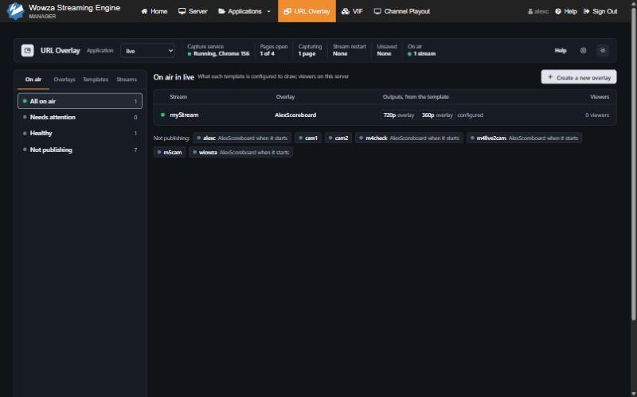
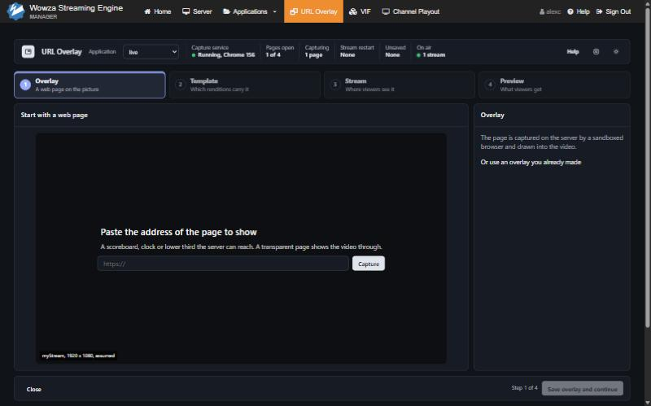
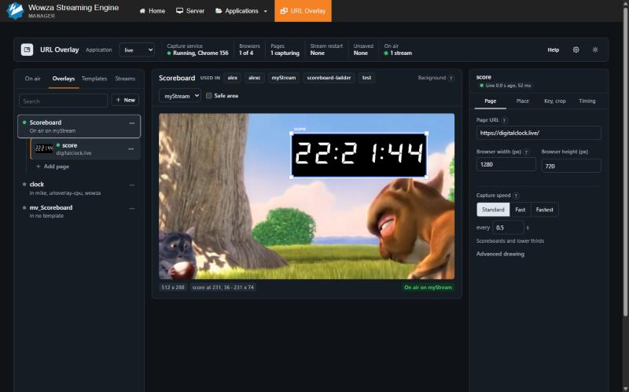
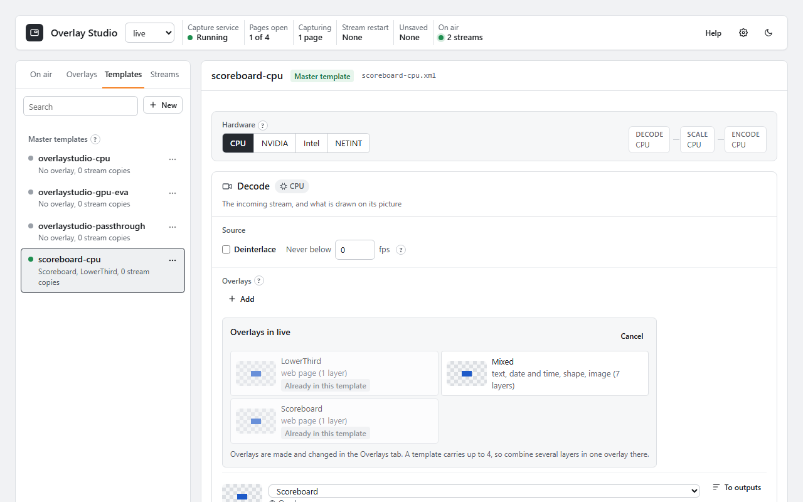
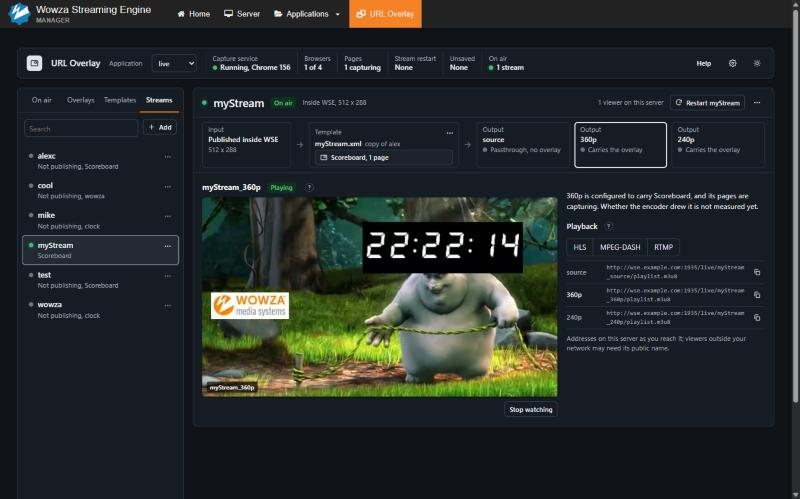
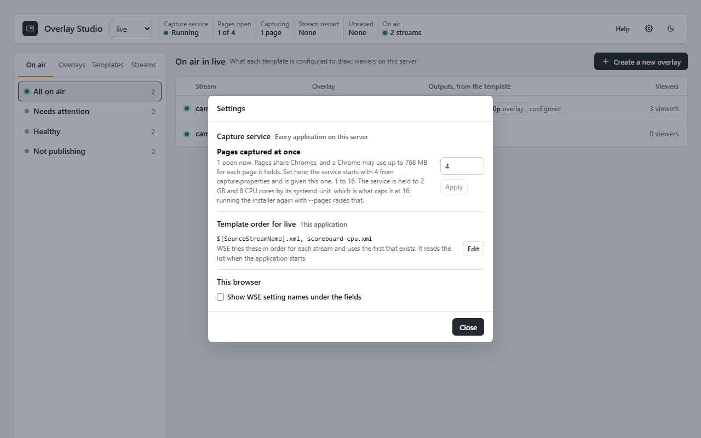
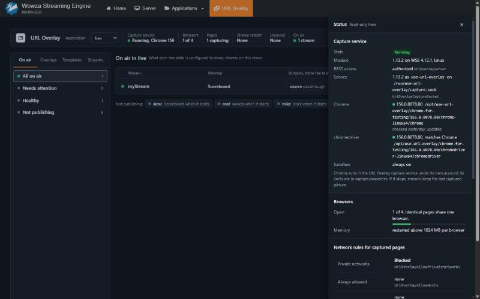

# Using Overlay Studio

Open WSE Manager, choose **Overlay Studio** in the top bar, and pick an application in the header. The page keeps itself
current: a change made in another browser, through REST or by editing a file shows within a few seconds.

<!-- 1x-compat:begin -->
Wowza Overlay Studio 2.0 replaces URL Overlay 1.x and is not compatible with it. Uninstall URL Overlay first;
overlays, templates and settings made with 1.x are not carried over.
<!-- 1x-compat:end -->

An overlay reaches viewers only through a transcoder template: a template names up to four overlays, a stream runs
that template, and the outputs that template builds carry them.

Changes need a WSE administrator (a REST user in the `admin` group). Anyone else sees the page read only.

The screenshots use a test feed from *Big Buck Bunny* (c) Blender Foundation, www.bigbuckbunny.org, licensed under
CC BY 3.0, with a public clock page as the overlay.

## The page

The header shows the capture service, the pages open against the limit, the pages capturing (and any failing or
blocked), streams waiting for a restart,
unsaved work and the streams on air. Each item opens the status drawer, except On air, which opens the On air list. **Help** lists the keyboard shortcuts, the
gear opens **Settings**, and the last button switches between the light and dark theme.

The list column has four tabs: **On air**, **Overlays**, **Templates** and **Streams**. The center shows the item picked
in the list. Every row in a list has a menu (**...**) with its actions. Deleting an item keeps the page in the same
list, on the next item.

Nothing is written while you edit. Each screen has one save bar at the bottom for its own object; unsaved work stays
while the page is open.

## On air

The application's publishing streams: the overlays each one's template names, the outputs it is configured to build
(each saying how many overlays it carries), and viewers on this server. The stream name, the overlay and the outputs each open their own screen. The list column
filters the streams: all on air, needing attention (a restart pending, or a template naming an overlay that does not
exist), healthy, and not publishing.

## Create a new overlay

**Create a new overlay** on On air puts a web page on a stream in four steps:

1. **Overlay**: paste a web page's address. The server captures it once before anything is saved, and places it
   inside title safe on a publishing stream. Or pick an overlay you already made.
2. **Template**: pick the renditions that carry the overlay, as a ladder.
3. **Stream**: pick a publishing stream, or name one that has not started yet. A dry run says what is written and
   whether a restart is needed before you apply it.
4. **Preview**: watch each output, marked as measured or as configured.

## Overlays

An overlay is a named set of up to 64 layers drawn on the video, saved per application in
`conf.modules/overlaystudio/<application>/<overlay>.json`. Overlays are made and changed here; a template only picks
them.

- **Layers** are listed under the open overlay in the list column; the top one draws on top, and rows can be dragged
  to reorder. **Add layer** under the list (and in the empty panel) adds one, each kind with its icon: **Web page**,
  **Text**, **Date and time**, the shapes (**Rectangle**, **Rounded rectangle**, **Square**, **Ellipse**, **Circle**,
  **Line**, **Arrow**, **Triangle**), **Image**, and **From a preset...**. A web page asks for its address; any other
  kind is placed with a click on the canvas, or drawn by dragging, while a banner on the canvas says so, with Cancel.
  A row's menu moves the layer up, down, to the front or to the back, duplicates it, reloads a web page, or removes it.
- **The overlay's menu** adds a layer, duplicates the overlay, or deletes it. An overlay a template carries cannot be
  deleted until no template names it.
- **New overlay** starts from one web page (captured once before anything is saved), a preset, a copy of another
  overlay, or empty.
- **The canvas** shows the layers on a publishing stream picked under **Background**, at that stream's size. The
  background is only for placing layers: when that stream does not show this overlay, the frame says *Background
  only*. Drag a layer to move it, drag its handles to resize or turn it, or nudge it with the arrow keys. **Safe area**
  shows title safe. A layer outside the frame, a missing image file or a character a font cannot draw is marked on its
  row; an overlay made for a larger picture offers **Fit to this stream**.
- **The server check** under the canvas: after each edit the server draws the draft at one moment and the page compares
  where each layer lands with the canvas, and says *Matches the server's drawing.* or how a layer differs. **Show the
  server's drawing** lays its picture over the canvas. It needs write access.
- **The inspector** has tabs for the selected layer:

| Layer | Tabs |
|---|---|
| Web page | **Page** (address, browser width and height, **Capture speed** for every page of the overlay: Standard 0.5 s, Fast 0.25 s, Fastest 0.1 s, or any value in seconds), **Place**, **Key, crop** (key color picked from the capture, tolerance, painting the page's background with the key color, and showing only part of the page), **Timing** (wait after load, reload every N seconds) |
| Text | **Text** (the text, font, size, style, color, alignment, a text style, and **Box and outline**: wrap in a box with a background, padding and corners, shrink to fit the box, line height, letter outline), **Place**, **Timing** |
| Text with a date or time | **Format** first: what it shows (the date and time now, a countdown to a target, a count-up from a target, or the time since the stream started), a format from a list or a pattern of your own, the target and the text at zero for a countdown, time zone and language |
| Shape | **Shape** (fill, or **No fill, the line only**; line color, width and style; arrow head on a line; gradient; corner rounding), **Effects** (shadow), **Place**, **Timing** |
| Image | **Image** (a file from the virtual host's `content/` folder or one uploaded, up to 2 MB, at most 4096 pixels a side), **Place**, **Timing** |

**Place** has X, Y, width and height on the source picture, turn, opacity, and for an image whether to keep its
proportions. **Timing**, for every kind, shows the layer from a stream time or a date and hides it at another, fades it in
and out, and blinks it.

- **Text and fonts.** The fonts are bundled with Overlay Studio and installed into WSE, so the video draws the same
  letters as the editor: Fira Sans (regular, bold, italic), Fira Sans Condensed (regular, bold, italic), Fira Mono
  (regular, bold) and PT Serif (regular, bold). A font named in an overlay that the server does not have is saved with a
  warning and drawn in Fira Sans.
- **Dates and times** are tokens in the text: `{time:HH:mm:ss}`, `{countdown:H:mm:ss}`, `{countup:mm:ss}` and
  `{streamtime:H:mm:ss}`; `{{` and `}}` draw a brace. The server redraws the text once a second, or once a minute when
  the pattern shows no seconds.
- **Presets** are ready layers: shapes; badges and bars (a live badge, blinking or not, a lower third, a title card, a
  ticker strip); a corner bug (an image waiting for its file); and dates and times. **Text styles** (Title, Lower third
  name, Lower third role, Caption, Ticker) set a text's font, size and colors. A preset placed in New overlay is laid out
  for a 1920 x 1080 picture.

Edits show on the canvas at once, marked unsaved. Nobody watching sees them until **Save**, which says how many live
streams it updates. **Discard** drops them; `Ctrl+Z` undoes. Saving updates every running stream showing the overlay
at once, with no restart. Streams showing the same page share one capture.

## Templates

Every transcoder template in the virtual host's `transcoder/templates/` is listed, except Video Intelligence ones:

- **Master templates** are the ones made here. You edit a master; putting it on a stream gives that stream its own
  copy, `transcoder/templates/<stream>.xml`, listed under the master. Saving a master changes no stream until its copy
  is updated. A copy that no longer matches its master says *Differs from <master>*, with **Update** beside it.
- **Other templates on this server**, such as WSE's own `transrate`. **New master from this one** in its menu starts a
  master from it.
- **Copies without a master**: a stream's copy whose master was deleted. The stream still runs it; deleting it makes
  the stream use the application's template order again.

A master is edited in three parts:

- **Hardware** for the whole template: CPU, NVIDIA, Intel or NETINT, and the device. Beside it, what decodes, scales
  and encodes. Anything but CPU needs that hardware on the server, and an overlay makes GPU frames go through system
  memory to be drawn on.
- **Decode**: deinterlace and a minimum frame rate for the source, and **Overlays**: what is drawn on the input, once
  and before scaling, so every video output shows it, in source pixels.
- **Encode**: the outputs, with an estimate of the encoding load (it assumes a 1080p, 30 fps source), and **Overlays on
  outputs**: what is drawn after scaling on the outputs picked for it, in each output's pixels.
- In either Overlays section, **Add** offers **Overlay** and **Image (fixed)**:
  - **Overlay** lists the application's overlays, each with a thumbnail and what it holds, and adds the one picked. An
    overlay the template already carries cannot be picked again. A template carries up to four overlays; combine
    several layers in one overlay for more. Each overlay card names where it draws: **To outputs** and **To Decode**
    move it, the up arrow draws it under the one before it in the same section, and on outputs it shows the outputs
    it is on. On outputs with every output picked, it is saved on the input, which every output then shows. With one
    video output there is no difference, so overlays stay in Decode. **Copy** sends the overlay to other applications
    that have Overlay Studio, marked *Has it*, *Differs* or *Missing*; replacing a different version asks first, and
    says when it is on air there.
  - **Image (fixed)** is an image WSE draws itself, with no timing: a file from the virtual host's `content/` folder (up
    to 8 MB), or one uploaded into `content/overlaystudio/` (up to 2 MB), at most 4096 pixels a side, at one of nine
    positions with an offset, size and opacity. Up to eight in a template, drawn under the overlays of the same
    section. Anything on an output draws over everything on the input.
- A new master starts with no overlay, from a ladder: **Original + overlay copy** (which asks for an overlay on its
  overlay output), **1080p, 720p, 360p**, **720p, 360p**, **Single 720p** or **Audio only**. Each output shows what
  scales and encodes it, and **Edit** opens Picture (size, fit, a region of the source), Frame rate, Video (H.264,
  H.265, VP8, VP9, profile, bitrate, and for H.264 rate control and speed), Audio, Captions and Expert (any encoder
  parameter by name). **Playback** sets adaptive groups: players open each output as `<stream>_<output>` and each group
  as `ngrp:<stream>_<group>`.

WSE's own templates have dynamic overlays off, so they cannot carry an overlay as they are. **Use it with an overlay**,
under the template, offers **Make a copy with the overlay**, or, for a template of your own, **Change <name> itself**:
changed in place after a backup, naming the applications that list it. A template changed in place shows its overlays
as a list with the outputs each is on. Video Intelligence templates are not listed; a stream running one says so and
cannot carry an overlay.

## Streams

The application's streams, publishing or with their own template copy. A stream's menu applies or changes its
template, stops using it, duplicates the stream, or deletes it.

- **Apply or change a template** writes the stream's own copy of a master. A dry run says first what changes: whether
  the application's transcoder is switched on, whether the stream leaves a VIF template, and when it picks the change
  up.
- **Stop using it** deletes the stream's copy; the stream then gets its template from the application's template
  order when it next starts.
- **Duplicate** gives a new stream name its own copy of the same master, for an encoder that has not started yet.
- **Delete** removes a stream's own copy and the name from the list. It is not offered while the stream publishes.

The stream view shows the input, the template (with the same template actions in its menu) and the outputs. Pick an
output to watch it, about 10 seconds behind live, with one sentence on what its viewers get. **Playback** lists the
address of every output and adaptive group for HLS and MPEG-DASH, when the application serves them, and RTMP, each with
a copy button. The addresses use the host name the page was opened with.

The stream view names every overlay its template carries and, for each output, the overlays it draws. Changing the
template says which overlays leave the stream, which arrive and which stay.

**What applies at once:** which overlays a template carries, and on which outputs. **What waits for a restart:** new
outputs, sizes or bitrates, images, the hardware, or a different template; such a stream is marked in the header. **Restart** resets a pulled
stream, disconnects an RTMP or RTP (RTSP, WebRTC) publisher so its encoder reconnects with the new template, or restarts
the application for a stream published inside WSE. Viewers see a short gap. Other pushed streams must be restarted at
the encoder.

Previews play from the streaming port (1935 by default). WSE's HTTP streamer allows this by default; setting
`cupertinoCORSHeadersEnabled` or `httpCORSHeadersEnabled` to false stops it.

The application picker also lists live applications without Overlay Studio. **Add Overlay Studio to <application>** adds the
module to its `Application.xml` (backed up, and taken out again by uninstall) and restarts the application, now or
later. Streams publishing to it disconnect for a few seconds; the dialog names them first.

## Settings in the page

- **Pages captured at once** changes the capture service's limit while it runs, with no restart, and keeps it for its
  next start. It starts from `maxCaptures` in `capture.properties`. On Linux the service's systemd unit caps its memory
  at install time, and the page never sets more pages than that cap holds; the dialog says how many that is. The cap
  leaves room for as many pages as the server is sized for (below), so it is usually above the number set. Run the
  installer again with `--pages` to raise it further.
- **Template order** edits the application's `Transcoder/Templates` (at most 12 entries): WSE uses the first file in
  the list that exists for each stream. The new order is saved to `Application.xml`, backed up first, and applies after
  the application restarts.
- **Show WSE setting names under the fields**, for this browser.

## Status drawer

Any item in the header opens the status drawer: the capture service (version, account, sandbox), Chrome with the last
update check, pages open and the Chromes they share, the memory limit, the network rules for captured
pages with recent blocks, streams waiting for a restart, and unsaved work. It is read only: each value names the
setting behind it.

## Settings on the server

### `conf/Server.xml`

Set by the installer when absent; change them there and restart WSE.

| Property | Default | Meaning |
|---|---|---|
| `OverlayStudioServer` | `authorized` | REST access: `authorized`, `unauthorized` (every change refused) or `disabled` (no resources) |
| `OverlayStudioCaptureSocket` | `/run/wse-overlay-studio/capture.sock` (Linux), `C:\ProgramData\WowzaOverlayStudio\capture.sock` (Windows) | Where WSE reaches the capture service |
| `OverlayStudioAllowPrivateNetworks` | `false` | Let pages load from private, CGNAT and unique-local ranges. Never opens loopback, link-local, cloud metadata or this server's own addresses |
| `OverlayStudioAllowHosts` | empty | Comma list of hostnames, addresses or CIDRs always allowed. Beats the private-range block, never `OverlayStudioBlockHosts`. Loopback, link-local and this server's own addresses open only for an exact address entry |
| `OverlayStudioBlockHosts` | empty | Comma list of hostnames, addresses or CIDRs always blocked |
| `OverlayStudioAllowPorts` | empty | Ports pages may use besides 80 and 443 |
| `OverlayStudioBlockChromeServices` | `true` | Refuse the Google hosts Chrome contacts on its own; an `OverlayStudioAllowHosts` entry lets one through |

A scoreboard served from a machine on your LAN (a private address) needs
`OverlayStudioAllowPrivateNetworks` set to `true` or its address in `OverlayStudioAllowHosts`.

### Application properties (`conf/<application>/Application.xml`, optional)

| Property | Default | Meaning |
|---|---|---|
| `OverlayStudioIndex` | `16` | The first transcoder overlay slot Overlay Studio draws in; a template's four overlays use it and the next three (16 to 19 by default), a higher slot on top. Image overlays use 1 to 8; a value whose slots would reach them is refused |
| `OverlayStudioDebugLogs` | `false` | Extra overlay logging |
| `OverlayStudioMaxDebugOverlayLogs` | `100` | Cap on those lines |
| `OverlayStudioInitTransparentOverlay` | `false` | On a stream's first frame, put a transparent overlay on every encoding output (a workaround for WSE builds that also drew output overlays on the source) |

### `capture.properties`

`/etc/wse-overlay-studio/capture.properties` on Linux, `C:\ProgramData\WowzaOverlayStudio\capture.properties` on Windows.
Written by the installer; restart `WowzaOverlayStudioCapture` after a change.

| Key | Default | Meaning |
|---|---|---|
| `socket` | required | The Unix socket the service listens on; must match `OverlayStudioCaptureSocket` |
| `chrome` | set by the installer | The Chrome the service runs: chrome-headless-shell on Linux, Chrome for Testing on Windows. A `chromedriver` line from an earlier version is ignored |
| `workDir` | required | Chrome profiles and work files |
| `maxCaptures` | sized from the server | Pages open at once when the service starts; one more is refused. A new install sets it from the server's cores and memory, and `--pages <n\|auto>` sets it on any install. **Settings** in the page changes it while the service runs |
| `pagesPerBrowser` | `4` | Pages one Chrome holds. Fewer means fewer pages lost when one Chrome exits, more means less memory |
| `maxBrowserMemoryMB` | `1024` | Memory a Chrome may use for each page it holds; above it, its largest page is restarted |
| `logFile` | standard output | The service's log; the installer sets `capture.log` in the service's log folder |
| `autoUpdate` | on | `false` stops the daily Chrome update. Read by the daily updater; the service ignores it |

On Linux the systemd unit's `MemoryMax` and `CPUQuota` are computed at install time from `maxBrowserMemoryMB` and the
larger of `maxCaptures` and the number of pages the server is sized for; run the installer again after raising them.

### Pages at once, from the server's size

A new install, and `--pages auto`, set `maxCaptures` from the server: a quarter of its cores at about 16% of a core per
page (a page at the Fastest speed, 0.1 s, in the first 1.15.0 measurement), and a quarter of its memory at 128 MB per page, whichever is smaller, from 2 to 32. WSE's own transcoding is
given the rest. Examples: 2 cores, 3 pages; 4 cores, 6; 8 cores and 16 GB, 12; 16 cores and 64 GB, 25. A reinstall
without `--pages` keeps the number set.

What a page costs depends on how often it changes and its size far more than on the capture rate. Measured with 1.15.0
on an 8-core server, 1920 x 1080 pages, 12 at once:

| Pages | CPU, all 12 | Per page | Memory per page |
|---|---|---|---|
| A clock that changes once a second, Standard or Fastest | 0.54 core | 0.045 core | 105 MB |
| Text that changes every 0.1 s, Fastest | 4.85 cores | 0.40 core | 109 MB |
| A 60 fps animation, Fastest | 5.56 cores | 0.46 core | 124 MB |
| A 60 fps animation, Standard | 1.90 cores | 0.16 core | 66 MB |

So 12 overlays that change now and then, such as scoreboards and lower thirds, use under a tenth of such a server,
while 12 that change many times a second at Fastest would use more than half of it. On Linux the systemd unit caps the
service's CPU (`CPUQuota`, 2 cores unless the server is sized for more than 12 pages), so heavy pages get fewer frames
rather than taking CPU from WSE: those 12 changing every 0.1 s, held to 2 cores, delivered 39% of their frames. Set
fewer pages, or Standard, for pages that animate all the time.

A number set in **Settings** in the page is kept in `conf.modules/overlaystudio/capture-limit.json` and replaces
`maxCaptures` while WSE runs; the installer reports it as the one in force, and `--pages` removes it. On Linux the
unit's memory cap stays within three quarters of the server's memory, so Settings may top out below the server's
size; a `--pages` above that is allowed and noted.

## Troubleshooting

Module lines are in WSE's `logs/wowzastreamingengine_access.log` (warnings also in `wowzastreamingengine_error.log`)
and all contain `OverlayStudio`. The capture service logs to `/var/log/wse-overlay-studio/capture.log` on Linux and
`C:\ProgramData\WowzaOverlayStudio\logs\` on Windows.

| What you see | Cause and fix |
|---|---|
| *The Overlay Studio bridge is not loaded in WSE Manager.* | The Manager was not restarted after the install, or the installer skipped the bridge because this Manager is not one it was built for (the install report says *The Manager bridge was not installed: this WSE Manager is not one it was built for (...)*). Run the installer again and restart WSE Manager. A skipped Manager cannot use the page |
| *The Manager bridge is version X and this page is Y.* | Run the installer again, then restart WSE Manager |
| *WSE could not be reached from this browser.* | WSE or WSE Manager is not running |
| *The capture service is not running.* | The page and status show: *The Overlay Studio capture service is not running (nothing answers on <socket>). Start it with "sudo systemctl start WowzaOverlayStudioCapture" on Linux or "net start WowzaOverlayStudioCapture" as an administrator on Windows.* Streams keep their last picture meanwhile. If it will not start, see its log and `systemctl status WowzaOverlayStudioCapture` or `sc query WowzaOverlayStudioCapture` |
| **Read only.** banner | *... is not in the admin group; changes need a WSE administrator.* Sign in as an administrator. Or *WSE REST authentication is off ...*: set `RESTInterface/AuthenticationMethod` to `basic` or `digest`, and `OverlayStudioServer` to `authorized` |
| *Blocked host: <host> resolves to <address> (<rule>). Allow it with the OverlayStudioAllowHosts server property.* | The page's address is private, loopback, link-local, metadata or this server. See Settings. A block after loading (an image or script the page fetches) shows on the page row as *Blocked: <rule> <address>* |
| *Blocked port: <port>. Pages are captured from ports ...; add others with the OverlayStudioAllowPorts server property.* | Add the port to `OverlayStudioAllowPorts` |
| *Chrome did not start in its sandbox (...). Captures stay off until it does; the service never runs Chrome without its sandbox.* | On Ubuntu 23.10 and later the message continues *This system restricts unprivileged user namespaces ...*: the AppArmor profile `/etc/apparmor.d/wse-overlay-studio-chrome` is missing or not loaded. Run the installer again, or check `aa-status`. On Windows, check that the service runs as `NT SERVICE\WowzaOverlayStudioCapture` and can read the Chrome folder |
| Overlay does not show on a stream | The stream view's sentence under the player says why. Usually the stream's template names no overlay, names one this application does not have (overlays are saved per application; **Copy** on the template's overlay card sends it), the transcoder is off, or the stream has not restarted since its outputs changed |
| A stream runs a VIF template | The overlay is skipped on it. Apply an Overlay Studio template from the stream's menu |
| *Differs from the server's drawing* under the canvas | The server draws a layer somewhere else than the editor shows, usually text in a font the server lacks. The line names the layer and by how much; **Show the server's drawing** shows the video's version |
| Linux: the page renders without text | Install `fontconfig` and a font package such as `fonts-liberation` |
| The installer stops with exit 3 | It cannot write to the WSE folder (run as administrator or with `sudo`), or WSE is running: stop it first |

Installer exit codes: 0 done, 1 bad arguments, 2 WSE not found or ambiguous (use `--home`), 3 preflight failed,
4 WSE older than 4.11.1, 5 failed and rolled back, 6 failed and rollback incomplete (the report lists what to restore
from the backups), 7 failed before anything was changed, 9 an earlier, incompatible version is installed (README, Before you install).
